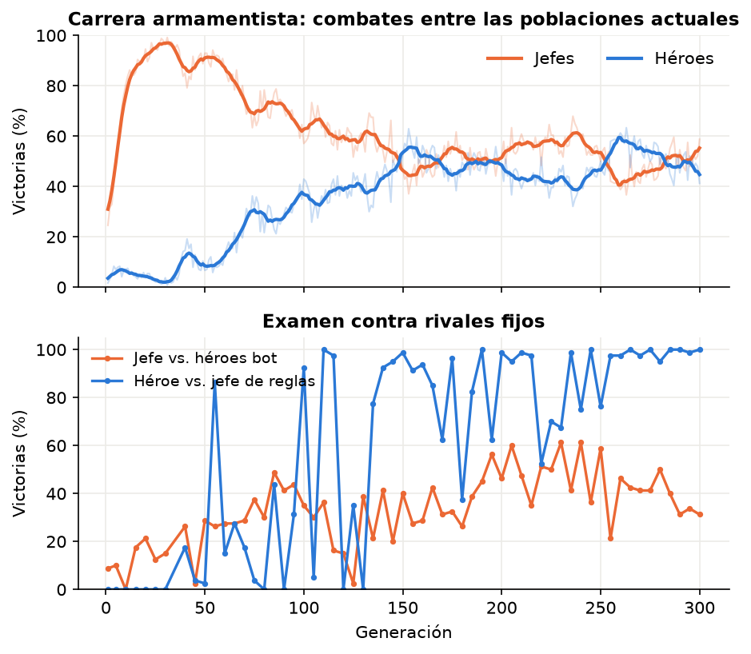

# Jefe evolutivo

Un jefe final de videojuego que **aprende a pelear solo** por neuroevolución: su
comportamiento lo decide una red neuronal y los pesos de esa red se optimizan con
un algoritmo genético, sin que nadie programe reglas a mano.

Trabajo Práctico Integrador de Inteligencia Artificial (Universidad de Palermo).
Agustín Elmer García — Prof. Ignacio Casais.


## Cómo funciona

| Componente | Archivo | Qué hace |
|---|---|---|
| Entorno | `jefe/arena.py` | Arena 2D: el jefe dispara y embiste, el héroe dispara y esquiva. Simula cientos de combates en paralelo con NumPy. |
| Agente (jefe) | `jefe/red.py` | Perceptrón multicapa 15 → 16 → 5 (341 pesos). Percibe 15 variables y decide 5 acciones. |
| Rivales | `jefe/jugadores.py` | 3 héroes bot de entrenamiento (agresivo, francotirador, escurridizo), 1 de prueba nunca visto (impredecible) y un jefe con reglas fijas como línea de base. |
| Aprendizaje | `jefe/genetico.py` | Algoritmo genético: selección por torneo, cruce uniforme, mutación gaussiana decreciente, elitismo. |
| Coevolución | `jefe/coevolucion.py` | Jefes y héroes (ambos redes neuronales) evolucionan uno contra el otro. |
| Gráficos del juego | `jefe/render.py` | Partículas, halos, estela de embestida, sacudida de pantalla y sonidos sintetizados. |
| Parámetros | `jefe/config.py` | Todo lo ajustable: balance del juego, red y algoritmo genético. |

**Percepciones del jefe (entradas):** posición relativa y distancia al héroe, velocidad del héroe,
posición y dirección de la bala enemiga más cercana, posición propia (paredes),
si puede embestir o disparar, su vida y la del héroe.

**Acciones (salidas):** dirección de movimiento (x, y), embestir, disparar y ajuste de puntería
(le permite aprender a "adelantar" el tiro).

**Aptitud (fitness):** daño causado − 0,5 × daño recibido + premio por ganar + premio por ganar rápido,
promediado en 6 combates (2 contra cada héroe de entrenamiento).

## Uso

```bash
python -m venv .venv && source .venv/bin/activate
pip install -r requirements.txt

python entrenar.py      # ~2-3 min en una PC común; guarda resultados/
python evaluar.py       # tablas y gráficos
python grabar.py        # GIF generación 1 vs. campeón
python jugar.py         # jugá vos contra el campeón (WASD + mouse)
python jugar.py --gen 1 # ...o contra el jefe recién nacido
python jugar.py --bot escurridizo   # mirar al jefe contra un héroe bot
python en_vivo.py       # coevolución en vivo: jefes y héroes evolucionan mientras mirás
python coevolucionar.py # la misma coevolución sin ventana (guarda resultados/coevolucion/)
python analizar.py      # indicadores de comportamiento (qué aprendió)
python diagramas.py     # diagramas conceptuales del informe
```

## Coevolución

En la versión base el jefe aprende contra héroes programados a mano. En la coevolución
(`jefe/coevolucion.py`) los héroes también son redes neuronales (14 → 12 → 4) y evolucionan
al mismo tiempo: cada especie es el rival de la otra. Para que ninguna "olvide" cómo vencer a
rivales anteriores, también pelean contra un salón de la fama con los campeones de cada
generación. Cada 5 generaciones se toma un examen contra rivales fijos (bots y jefe de reglas),
porque la aptitud en la coevolución es relativa.



## Jugar

`./jugar.sh` (o `python jugar.py`) abre un menú para elegir el jefe (fácil = generación 1, medio = generación 50,
difícil = campeón, coevolucionado) y quién pelea (jugador, un bot o el héroe coevolucionado).
Desde el menú, la tecla **E** abre la coevolución en vivo. Cuando jugás vos, el combate dura 60 s y tus balas hacen más daño que las de los bots.

Los bots disponibles son `agresivo`, `francotirador`, `escurridizo` (entrenamiento) e `impredecible` (prueba).
El balance original está calibrado para los bots, que disparan sin pausa y apuntan muy bien; por eso el
modo humano tiene sus propias reglas (`HUMANO_*` en `jefe/config.py`).

## Datos

No se usa ningún dataset externo: los datos de entrenamiento se **generan por simulación**
(cada combate es un ejemplo). Los resultados de la corrida reportada están en `resultados/`:

- `historial.csv` — aptitud máxima/media/desvío y victorias por generación.
- `comparacion.csv` — 300 combates de cada jefe contra cada estilo de héroe.
- `campeon.npy`, `mejores_por_generacion.npy`, `poblacion_final.npy` — genomas (pesos) guardados.
- `*.png`, `*.gif` — figuras usadas en el informe.

La semilla por defecto es 42, así que `python entrenar.py` reproduce la misma corrida.
